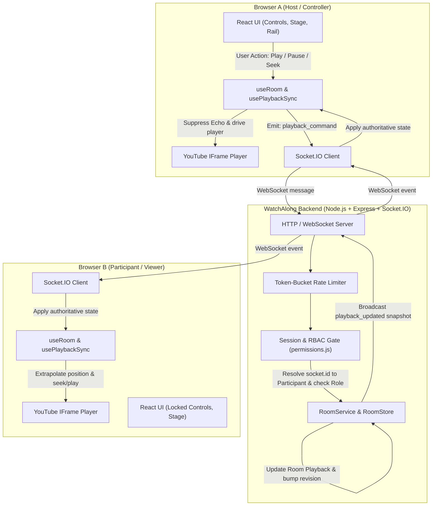

# WatchAlong — System Architecture

This document describes the architectural design, synchronization model, security boundaries, and lifecycle management of WatchAlong.

---

## 1. High-Level System Architecture



---

## 2. Architectural Boundaries & Component Separation

### Backend Modules

1. **HTTP Layer (`server/src/app.js`)**:
   - Manages Express middleware: CORS origin checking, JSON parsing caps (10KB limit), and security headers (`x-powered-by` disabled).
   - Serves the `/health` liveness probe and `/api/rooms/:roomId` public pre-check endpoint (exposing only room existence and participant count, zero private data).
2. **Real-time Event Engine (`server/src/realtime/socketServer.js`)**:
   - Manages WebSocket connections and enforces per-socket rate limiting via a token-bucket algorithm (`capacity: 40`, `refill: 8/s`).
   - Maintains the server-side `sessions` map (`socket.id -> { roomId, participantId }`). The client payload is **never** consulted to determine who is acting.
   - Delegates event payloads to focused domain handlers (`roomHandlers.js`, `playbackHandlers.js`, `roleHandlers.js`).
3. **Domain Business Logic (`server/src/rooms/roomService.js`)**:
   - Contains 100% of room lifecycle, playback state transitions, participant re-attachment, and host succession logic.
   - Zero awareness of Socket.IO primitives: methods take an authoritative identity tuple `{ roomId, participantId, socketId }` and return plain snapshot objects.
   - Dispatches background asynchronous state changes (e.g., reconnect grace period timeouts) via standard Node.js `EventEmitter`.
4. **State Storage (`server/src/rooms/roomManager.js`)**:
   - `RoomStore`: In-memory repository with CSPRNG room code generation. Decoupled from `RoomService` so a MongoDB or Redis repository can be swapped in without modifying any playback synchronization code.
5. **Security & Authorization Gate (`server/src/auth/permissions.js` & `sessionIdentity.js`)**:
   - Pure authorization matrix (`assertCan(participant, action)`).
   - Constant-time token verification (`crypto.timingSafeEqual`) for reconnect tokens.

---

## 3. Real-Time Synchronization Model

### The Problem of Distributed Video Playback
Direct peer-to-peer playback control suffers from three fatal problems:
1. **Clock Skew**: System clocks between separate client devices easily drift by several seconds.
2. **Network Jitter**: Packets arriving at slightly different times cause players to start at mismatched moments.
3. **Buffering Differences**: One client might buffer 200ms longer than another, creating immediate divergence.

### WatchAlong's Authoritative Snapshot & Extrapolation Model

1. **Server Timestamp Anchoring**:
   When a play command is accepted at server timestamp $T_{\text{update}}$ with position $P_{\text{anchor}}$, the room playback state is:
   $$\text{Room State} = \{ \text{status}: \text{'playing'}, \text{position}: P_{\text{anchor}}, \text{updatedAt}: T_{\text{update}}, \text{revision}: R \}$$

2. **Snapshot Extrapolation**:
   When any participant (including a newly joined client) requests state at current server time $T_{\text{now}}$, the server computes:
   $$P_{\text{now}} = P_{\text{anchor}} + \max(0, T_{\text{now}} - T_{\text{update}})$$
   The client receives this absolute position, meaning the client does not need to synchronize system clocks with the server.

3. **Client-Side Playback Driver (`usePlaybackSync.js`)**:
   When the client receives snapshot $S$ at local client time $t_{\text{recv}}$, at any local time $t$ it knows the expected video position:
   $$P_{\text{expected}}(t) = S.\text{position} + (t - t_{\text{recv}})$$

4. **Calibrated Drift Policy (`decideDriftAction`)**:
   - **$|\text{drift}| < 0.75\text{s}$**: Ignored. Normal playback continues smoothly.
   - **$0.75\text{s} \le |\text{drift}| < 2.5\text{s}$**: Moderate drift. Flagged on check $N$. If still present on check $N+1$ (4 seconds later), seek is applied. This avoids seeking due to short-lived network hiccups.
   - **$|\text{drift}| \ge 2.5\text{s}$**: Hard seek applied immediately.
   - **Cooldown Barrier**: After every seek, a 4-second cooldown suppresses further corrective seeks while YouTube fills its playback buffer.

5. **Loop Prevention (`isApplyingRemote`)**:
   Whenever the client programmatic driver executes `controller.seekTo()` or `controller.play()`, it activates an `applyingUntilRef` window (1200ms). Any YouTube player events fired during this window are tagged as remote-applied, preventing feedback loops where remote updates are re-broadcast as local user interactions.

---

## 4. Connection & Session Lifecycle

```
[User Enters Room Link]
         │
         ▼
[Check sessionStorage for token]
    ├── Found: Send token with join_room (Reconnection)
    └── Missing: Prompt for Display Name (First-Time Join)
         │
         ▼
[Server Validation]
    ├── Valid Token & Matching Seat -> Reattach socket, cancel grace timer
    ├── Token in removedTokens -> REJECT (REMOVED_FROM_ROOM)
    └── New Join -> Assign new participantId, secret token, role = PARTICIPANT
         │
         ▼
[Socket Disconnects (network drop / tab closed)]
         │
         ▼
Server: Mark connected = false
Server: Start 45-second Grace Timer
Server: Broadcast room_state (avatar dimmed / "reconnecting...")
         │
         ├── User reconnects within 45s -> Reattach to seat, cancel timer
         └── Timer expires -> Evict seat; if Host, trigger Host Succession
```

### Host Succession Policy
If the host permanently disconnects, WatchAlong ensures the room is never left orphaned:
1. Promote the longest-standing active **Moderator** who is currently connected.
2. If no moderators exist, promote the longest-standing active **Participant** who is connected.
3. If all members disconnect and the grace period expires, the empty room is pruned from memory.

---

## 5. Security Architecture

1. **Zero Client Trust**: Sockets are bound to `{ roomId, participantId }` on join. Every inbound command looks up permissions from server memory.
2. **Token Security**: Reconnect tokens are generated via `crypto.randomBytes(24)` and verified with constant-time equality comparisons (`crypto.timingSafeEqual`) to prevent timing side-channels.
3. **No External URL Fetching (SSRF Prevention)**: YouTube video IDs are extracted purely via regex and URL parsing. The server never fetches external URLs.
4. **Input Constraints**:
   - Room code: Strict 10-character alphabet (`[A-Z2-9]`).
   - Video ID: Strict 11-character base64url pattern.
   - Display name: Sanitized, whitespace-collapsed, capped at 24 characters.
   - Seek position: Upper bounded to prevent infinite floats.
5. **Rate Limiting**: Sockets exceeding 40 events/burst are throttled with `RATE_LIMITED` error codes.

---

## 6. Enterprise Extensions & Scalability

### Object-Oriented WebSocket Server Architecture
The server is structured around clean domain models and message handling hierarchies:
- **`Room` (`server/src/rooms/Room.js`)**: Encapsulates participant maps, playback revisioning, chat history buffer (capped at 100 messages), host transitions, and serialization.
- **`Participant` (`server/src/rooms/Participant.js`)**: Encapsulates participant credentials, connection health, role changes, and secure projection methods (`toPublic()` vs `toPrivate()`).
- **`BaseMessageHandler` (`server/src/realtime/handlers/BaseMessageHandler.js`)**: Base class providing identity extraction, safe broadcasting helpers, and uniform rate-limiting wrappers.
- **Specialized Handlers**:
  - `RoomMessageHandler`: Lifecycle operations (create, join, leave, reattach, displacement).
  - `PlaybackMessageHandler`: Authoritative synchronization commands (play, pause, seek, change video).
  - `RoleMessageHandler`: RBAC role assignments, host transfers, and participant kicks.
  - `ChatMessageHandler`: In-room text messaging and live synchronized reaction bursts.

### Horizontal Scalability & Redis Pub/Sub
To scale across multiple server instances targeting **1,000+ concurrent users**, **100+ active rooms**, and **50+ users per room**:
- **Socket.IO Redis Adapter (`server/src/realtime/redisAdapter.js`)**: Configured via `@socket.io/redis-adapter` and `redis`. When `REDIS_URL` is set, room broadcasts (`playback_updated`, `role_updated`, `chat_message`, `reaction_broadcast`) are published to Redis Pub/Sub channels and fanned out across all cluster instances.
- **Load Balancing**: Standard Layer 7 reverse proxy (e.g., NGINX, AWS ALB) with WebSocket upgrade headers (`Upgrade: websocket`) and sticky sessions using the Socket.IO session cookie.
- **Graceful Fallback**: If `REDIS_URL` is not configured, the server defaults to high-performance standalone in-memory routing.

### Persistent Rooms
- **`PersistentRoomStore` (`server/src/rooms/persistentRoomStore.js`)**: Extends `RoomStore` to persist room IDs, participants, chat history, and playback states to disk (`data/rooms.json`) or a document DB. Room states survive server restarts and reboots automatically.

### In-Room Text Chat & Live Reactions
- **Text Chat**: Real-time messaging with participant role badges (Host, Moderator, Participant), timestamp formatting, unread badge indicators, and automated system announcements.
- **Floating Emoji Reactions**: Users can tap reaction emojis (`🔥`, `❤️`, `😂`, `👏`, `🍿`, `🤯`, `🚀`, `💯`) which float upward over the video stage in synchronized CSS animations for all room members.
- **Host Transfer**: Room owners can transfer full Host control to any moderator or participant with an instant confirmation dialog and automatic role handoff.
